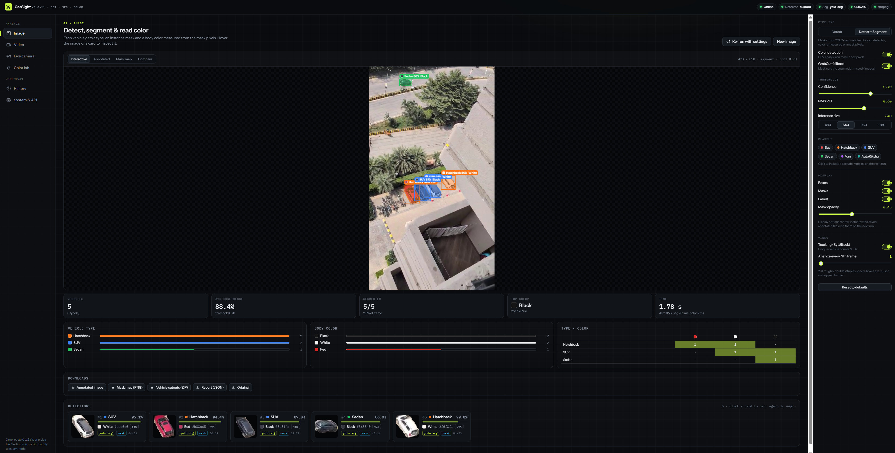
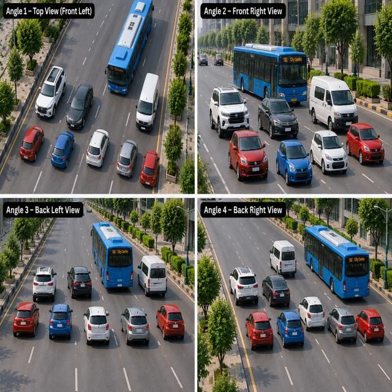
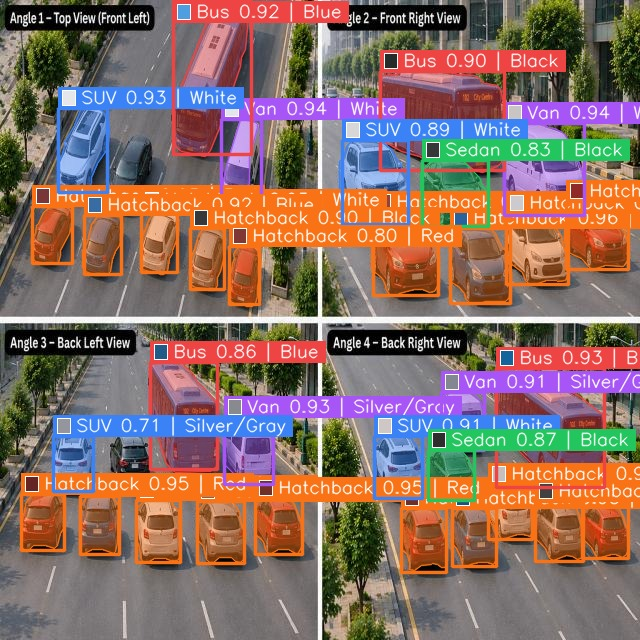
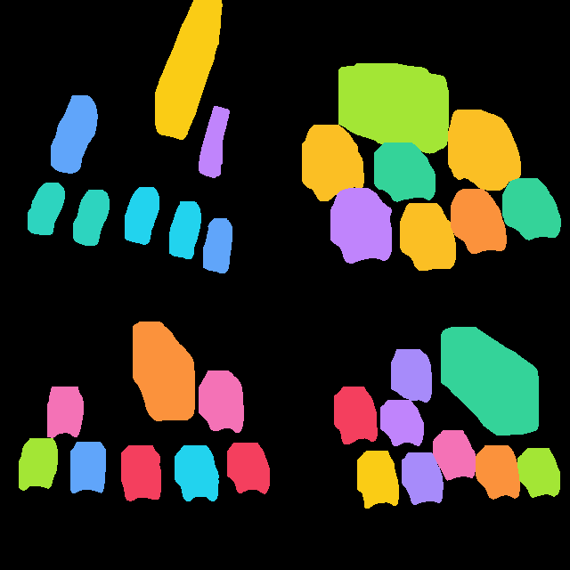
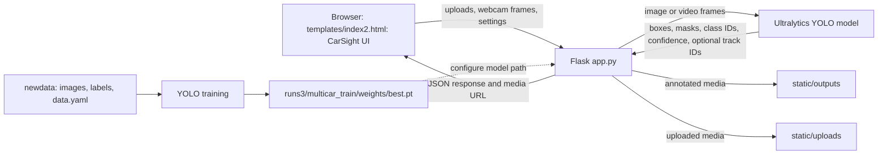

# MultiCar: Vehicle Detection, Segmentation & Color Analysis

MultiCar is a Flask web application for vehicle detection, instance segmentation, and body-color analysis across uploaded images, uploaded videos, and live webcam frames. Its browser interface is `templates/index2.html` (CarSight), backed by the routes and inference pipeline in `app.py`.

## Dashboard overview

The application presents a dark, analytics-style CarSight workspace with a left navigation rail for the main workflows, a large central canvas for image or video preview, and a right-side settings panel for model controls. In the main view, users can switch between Image, Video, Live, Color Lab, History, and System & API modes, preview detections directly on the media, and inspect confidence, class counts, area summaries, and per-object results in one place.

This UI is designed around a streamlined detection pipeline: upload media, choose detect or segment mode, adjust confidence and IoU thresholds, review annotated output, and then export the results or open job history from the same dashboard.



### More examples

<div align="center">
  <table>
    <tr>
    <td align="center"></td>
      <td align="center"></td>
      <td align="center"></td>
    </tr>
  </table>
</div>

> **Project status:** the repository contains the web application, datasets, pretrained weights, and training runs. The System & API page reports the detector and segmenter paths actually loaded at runtime. Confirm those paths and classes before interpreting results.

## Contents

- [What the application does](#what-the-application-does)
- [Architecture](#architecture)
- [Inference pipeline](#inference-pipeline)
- [Dataset and classes](#dataset-and-classes)
- [Training pipeline](#training-pipeline)
- [Run locally](#run-locally)
- [HTTP API](#http-api)
- [Repository layout](#repository-layout)
- [Known limitations and next steps](#known-limitations-and-next-steps)

## What the application does

- **Image analysis:** drag/drop, browse, or paste an image; run detection or detection plus instance segmentation; inspect interactive detections, masks, annotated output, and an original/result comparison. Results include class/color breakdowns, confidence, area, timing, and per-object details.
- **Vehicle color:** optionally estimate body color using HSV pixel rules over a segmentation mask or bounding box. The Color Lab shows the selected mask and decision ratios; image detections can be sent there for inspection.
- **Video analysis:** upload a video for a background job with upload, processing, and encoding progress, ETA, cancellation, and status polling. Optional tracking assigns vehicle IDs and aggregates type/color votes into unique-vehicle summaries. Frame-skip controls trade detail for speed.
- **Live camera:** use a browser webcam on localhost or HTTPS; choose a camera, send resolution and request rate, view live overlays and counts, and save a snapshot.
- **Controls:** choose detect/segment mode, classes, confidence and NMS IoU thresholds, inference size, color analysis, GrabCut refinement, annotation layers, mask opacity, tracking, and video frame skip. Settings persist in browser local storage.
- **Results and exports:** annotated image/video, segmentation mask map, per-vehicle image cutouts ZIP, JSON report, video timeline, and CSV summary (per-track when tracking is available, otherwise grouped detections). Browse, reopen, filter, and delete saved results in History.
- **System status:** inspect detector/segmenter weights, classes, runtime device, FFmpeg availability, upload limit, active jobs, API routes, and health state.
- Detects vehicle classes according to the loaded model. The merged `newdata` training classes are Bus, Hatchback, SUV, Sedan, Van, and AutoRiksha.

The color estimate is a simple image-pixel heuristic, not a separately trained color model. Lighting, shadows, tinted windows, small boxes, and aerial camera angles can make it inaccurate. The vehicle label is the detector's class (such as SUV or Hatchback), not a manufacturer/model such as Toyota Corolla.

Color labels are heuristic estimates, and video tracking depends on the configured model and tracker runtime. Tracking produces IDs and unique-vehicle aggregates; it does not estimate real-world vehicle speed or enforce speed limits.

## Examples

Vehicle detection, segmentation masks, and color labels:


### Direct Feed Showcase

<div align="center">
  <table width="100%">
    <tr><td align="center"><strong>▣ &nbsp; annotated2.mp4 &nbsp;⌄</strong></td></tr>
    <tr><td align="center" bgcolor="#0d1117">
      <video src="docs/images/annotated.mp4" controls playsinline width="100%" style="display:block; max-width:960px; width:100%; aspect-ratio:16 / 9; height:auto; border-radius:8px; margin:0 auto; background:#000;">
        Your Markdown viewer does not support embedded video. <a href="docs/images/annotated(1).mp4">Open or download the MP4</a>.
      </video>
    </td></tr>
  </table>
</div>

[Open or download the full annotated video](docs/images/annotated.mp4) · 15 seconds

## Architecture



### Main components

- **Frontend:** `templates/index2.html` implements Image, Video, Live, Color Lab, History, and System & API tabs, plus a shared settings panel. It handles file selection/drop/paste, XHR upload progress, job polling, result visualization, and downloads.
- **Backend:** `app.py` validates and stores uploads, parses bounded inference options, invokes models, annotates and exports results, and exposes prediction, job, history, configuration, and health routes.
- **Models:** the app loads a YOLO detector and an optional segmentation model at startup. Depending on the loaded weights, detection and segmentation can be separate passes or one custom model pass. The System page reports the active model paths and availability.
- **Analysis:** detections may include bounding boxes, segmentation polygons/masks, HSV color estimates, area ratios, and timings. Video uses a per-job tracker when enabled; class/color votes across each track provide unique-vehicle summaries. If tracking is unavailable or disabled, CSV output falls back to grouped detections.
- **Training data:** `newdata/` is the merged six-class dataset described below.
- **Training artifacts:** `runs/`, `runs2/`, and `runs3/` contain experiment outputs. The latest configured training run is `runs3/multicar_train/`.

## Inference pipeline

### Image request

1. The browser posts an image and the selected settings to `/predict_image`.
2. Flask validates the extension, saves the upload, and decodes it with OpenCV (Pillow fallback for formats such as GIF).
3. The selected detector runs with the confidence, IoU, inference-size, and class filters. Segment mode adds instance masks; image mode can use GrabCut refinement when needed.
4. Optional HSV color analysis runs over each mask or box. The backend draws the enabled annotation layers and saves a thumbnail, annotated image, optional mask map, cutouts ZIP, and JSON report.
5. The JSON response contains detections, statistics, timings, settings, and URLs for the source and generated files.

### Video request

1. The browser uploads a video to `/predict_video`; Flask returns a job ID immediately (HTTP 202).
2. A background worker decodes frames, analyzes every configured Nth frame, and updates progress, processing rate, and ETA. Results are reused for display on skipped frames.
3. When enabled, a per-job YOLO tracker assigns track IDs. The app aggregates class and color votes, filters very short tracks, and creates vehicle thumbnails and `vehicles.csv`.
4. Annotated frames are encoded as H.264 with FFmpeg when available. The result includes a playable video, detection timeline, statistics, JSON report, and CSV; polling `/jobs/<id>` provides status and the completed result. Jobs can be cancelled with `/jobs/<id>/cancel`.

Tracking IDs depend on visual continuity and may split or merge across occlusion. Unique-vehicle counts are therefore estimates. The application does not estimate vehicle speed.

## Dataset and classes

`newdata/data.yaml` points to the merged dataset using YOLO detection format:

| Split | Images | Labels |
| --- | ---: | ---: |
| Train | 825 | 825 |
| Validation | 245 | 245 |
| Test | 122 | 122 |
| **Total** | **1,192** | **1,192** |

Each image has a matching YOLO text label file. A non-empty label line contains `class_id x_center y_center width height`; coordinates are normalized to the image dimensions.

The merged class IDs in `newdata/data.yaml` are:

| ID | Class |
| ---: | --- |
| 0 | Bus |
| 1 | Hatchback |
| 2 | SUV |
| 3 | Sedan |
| 4 | Van |
| 5 | AutoRiksha |

`newdataset_v3/` was a five-class dataset using the first five IDs above. The `car_v2 (1).zip` archive was extracted to `autodata/`; its original IDs were Sedan=0, SUV=1, Hatchback=2, Van=3, Bus=4, AutoRiksha=5. When `newdata/` was assembled, archive labels were remapped to the six-class order in the table. `autodata/` preserves the extracted archive's original labels and `data.yaml`; use `newdata/` for the merged training configuration.

The original `newdataset_v3/README.dataset.txt` reports a CC BY 4.0 Roboflow export. Preserve its attribution and license terms when redistributing that source data. Check the source archive's terms separately before redistributing its data.

## Training pipeline

The saved configuration at `runs3/multicar_train/args.yaml` records a YOLO training run with:

- Model initialization: `yolo11l.pt` (large YOLO11 checkpoint).
- Dataset: `D:\MULTICAR\newdata\data.yaml`.
- Task: object detection; image size 640; batch size 16; configured for 40 epochs.
- Device: CUDA device `0`; validation enabled; output directory `runs3/multicar_train/`.
- Weights: `runs3/multicar_train/weights/best.pt` and `last.pt`.

The available `results.csv` currently has 11 epoch rows, so it does not show a completed 40-epoch run. Its last recorded validation metrics are precision 0.51043, recall 0.51857, mAP50 0.48870, and mAP50-95 0.35779. These values describe that partial log only; they are not a guarantee of application performance.

To reproduce training, install the dependencies and run an equivalent Ultralytics command from the repository root (adjust the device and paths for the machine):

```powershell
yolo detect train model=yolo11l.pt data=newdata/data.yaml epochs=40 imgsz=640 batch=16 device=0 project=runs3 name=multicar_train
```

## Run locally

Use Python 3.10 or newer and install the packages used by the application. The repository currently has no dependency lock or `requirements.txt` file.

```powershell
python -m venv .venv
.\.venv\Scripts\Activate.ps1
python -m pip install --upgrade pip
python -m pip install flask flask-cors ultralytics opencv-python numpy pillow
python app.py
```

Open `http://127.0.0.1:5000` in a browser. PyTorch is installed as an Ultralytics dependency; choose the appropriate PyTorch build for your CPU/GPU environment if needed.

`app.py` currently starts Flask with debug mode enabled and binds to `0.0.0.0`. This is intended for local development, not an internet-facing production deployment. Configure a production WSGI server and secure upload handling before deploying publicly.

## HTTP API

| Method and path | Purpose |
| --- | --- |
| `GET /` | Render the CarSight interface. |
| `POST /predict_image` | Accept `image` plus optional settings; return detections, statistics, timings, and annotated/mask/cutout/report URLs. |
| `POST /predict_frame` | Analyze one live webcam frame (`frame` multipart upload or JSON base64 `image`). |
| `POST /analyze_color` | Analyze an image/crop color and return HSV decision details; optionally segment first with `use_mask`. |
| `POST /predict_video` | Accept `video`, start a background job, and return HTTP 202 with `job_id` and `status_url`. `sync=1` requests synchronous processing. |
| `GET /jobs` · `GET /jobs/<id>` | List jobs or retrieve job status, progress, and final result. |
| `POST /jobs/<id>/cancel` | Request cancellation of a queued or running video job. |
| `GET /history` | List up to 200 saved image/video results. |
| `DELETE /history/<id>` · `DELETE /history` | Delete one saved result or clear completed results. |
| `GET /config` | Return defaults, vehicle classes, color palette/rules, model details, and upload limits. |
| `GET /health` · `GET /model_info` | Report health/job count or model classes, paths, and runtime information. |

Prediction settings include `mode` (`detect` or `segment`), `conf`, `iou`, `imgsz`, `color`, `refine` (`auto` or `off`), `classes`, `show_boxes`, `show_masks`, `show_labels`, `mask_alpha`, `frame_skip`, and `track`. Uploads are limited to 500 MB; accepted image and video extensions are defined in `app.py`. Invalid requests return an `error` field and an HTTP error status.

## Repository layout

```text
.
├── app.py                         # Flask routes and inference logic
├── templates/
│   └── index2.html                # Browser UI and fetch handlers
├── static/
│   ├── uploads/                   # Uploaded images/videos
│   └── outputs/                   # Annotated results
├── newdata/                       # Merged six-class training dataset
│   ├── data.yaml
│   ├── train/{images,labels}/
│   ├── valid/{images,labels}/
│   └── test/{images,labels}/
├── newdataset_v3/                 # Original five-class dataset and metadata
├── autodata/                      # Extracted car_v2 archive, original labels
├── runs/, runs2/, runs3/           # Training and prediction experiment outputs
├── yolo11l.pt, yolo11m.pt, ...    # Local pretrained checkpoints
└── README.md
```

## Known limitations and next steps

1. **Model selection:** detector weights are selected from `DET_MODEL`, `D:/carmodel2/weights/best.pt`, then `D:\MULTICAR\runs3\multicar_train\weights\best.pt`, with `yolo11n.pt` as fallback. Set `DET_MODEL` to choose a checkpoint explicitly. The segmenter defaults to `yolo11s-seg.pt` and can be changed with `SEG_MODEL`.
2. **Color estimates:** HSV rules are a lightweight pixel heuristic, not a trained color classifier. Lighting, paint reflections, shadows, small masks, and camera angle can affect the result.
3. **Tracking:** ByteTrack IDs and unique counts can change with occlusion, missed detections, or tracker availability. When tracking is disabled or unavailable, video summaries represent grouped detections rather than unique vehicles.
4. **No speed measurement:** tracking does not calculate real-world speed. That would require camera calibration and conversion from image motion to physical distance.
5. **Input and deployment:** extension checks are followed by image/video decode attempts, but malformed media and resource failures remain possible. Flask debug mode is enabled by default for local development; use a production WSGI server and secure upload handling before public deployment.
6. **Reproducibility:** the repository has no dependency lock or `requirements.txt`; record tested package versions for repeatable setup.

---

## Ownership and attribution

This project was developed and is owned by me. All work in this repository, including the application, model setup, interface, datasets, and documentation, was created and completed by me.

- Owner: Vansh Sharma
- Project: MultiCar
- Built and maintained by: Vansh Sharma
